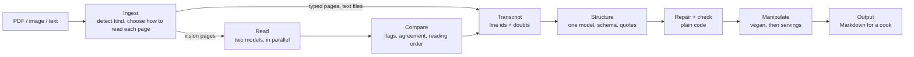

# Cookbook challenge

A pipeline that turns a scanned or typed recipe into structured data you can scale and make vegan, and into a recipe a person can cook from.
Built for the finlyt engineering case study. Stages: **ingest, extract, manipulate, output**.

- [Setup](#setup) and [run the whole app](#run-the-whole-app)
- [Running each stage](#running-each-stage) from the command line, and [on your own recipes](#try-it-on-your-own-recipes)
- [Architecture overview](#architecture-overview)
- [Challenges and decisions per stage](#challenges-and-decisions-per-stage)
- [The AI challenges](#the-ai-challenges)
- [What I would do with another week](#what-i-would-do-with-another-week)

## Setup

You need Python 3.10 or newer. From the project folder:

```powershell
python -m venv .venv
.venv\Scripts\Activate.ps1
pip install -e ".[dev,web]"
```

On macOS or Linux, activate with `source .venv/bin/activate` instead. Activate the environment again in every new terminal.

If PowerShell refuses to run the activation script, run `Set-ExecutionPolicy -Scope CurrentUser RemoteSigned` once.

### API key (needed to read an image or a scan, to structure a recipe, and to make it vegan)

The program calls the Gemini API. Copy the example file and put your key in it:

```powershell
Copy-Item .env.example .env
```

Then edit `.env` and set `GEMINI_API_KEY=`. Optionally set `GEMINI_MODEL=` (primary reader), `GEMINI_SECOND_MODEL=` (second reader) and `GEMINI_FALLBACK_MODELS=` (comma-separated). `.env` is gitignored, so never commit it.

**Claude (optional).** A reader can also be a Claude model, which makes the two readings more independent than two Gemini models. Install the extra package and add a key (from the Anthropic Console, not the Claude app) to `.env`:

```powershell
pip install -e ".[claude]"
```

```
ANTHROPIC_API_KEY=...
```

Claude is paid and has no free tier that I know of. The default is `claude-haiku-5-5`, the cheapest current model; set `CLAUDE_MODEL=` or `CLAUDE_SECOND_MODEL=` to change it. Usage is billed to whatever account the key belongs to, so use a key you are allowed to spend on this. This reader is built and tested offline but has not been run on a real page.

### The recipe PDF

`Recipe.pdf` (the scanned Sauerbraten) is **not** in the repository, because it is a page from a printed book. Put your copy in the project folder next to this README. The name is already in `.gitignore`. Other recipes work the same way: any file you pass is read from where it is.

## Run the whole app

```powershell
python -m cookbook.web
```

It opens http://127.0.0.1:8000 (this computer only; `--port` changes it, `--no-browser` does not open one). Drop `Recipe.pdf`, another PDF, an image or a text file on the page. Then, in three steps:

1. **Check the text.** The two models read the page and the page shows what they read next to the original. Every word they read differently is listed under "Doubts" and underlined in the text, red for numbers and amber for words, with the percentage of agreement of each page. Click one to choose either reading or type your own, or check a line off when it is right. The doubts of all pages are listed up front, so none is found only by visiting its page.
2. **Check the recipe.** A model turns the confirmed text into ingredients, tools, steps and servings. Each value is editable and shows the quote it came from; the checks' warnings are coloured by severity (high, medium, low), and a warning you have looked at can be checked off. "Re-check" runs the checks again on your edits.
3. **Change the recipe.** Make it vegan, change the number of servings, or both. The result shows the original beside the new recipe and a log of every change with its reason, with warnings first.

**Preview recipe** (steps 2 and 3) opens the recipe as a cook would read it, and **Download .md** saves it as Markdown. See [web.md](web.md) for how the page works.

The page opens without a key, and says so as soon as a model is needed: reading a file and every later step need the key from Setup.

### Run with Docker instead

If you have Docker and would rather not set up Python, the web page can run in a container. You need only the key:

```powershell
Copy-Item .env.example .env
# edit .env and set GEMINI_API_KEY=
docker compose up
```

Then open http://127.0.0.1:8000. The first run builds the image. The key is not baked into it: Compose passes `.env` in when the container starts, and `.dockerignore` keeps `.env`, `data/`, PDFs and `.git` out of the build. The port is published on `127.0.0.1` only, so the page, which can use your key, is not reachable from the network. Model answers are cached in a Docker volume (`cache`), so a page read once is free to read again, also after a restart; `docker compose down -v` removes it. Stop with Ctrl+C, or `docker compose down`.

Only the web page runs this way. The stage commands below (`python -m cookbook.extract` and the others) run from the virtual environment of Setup, where they read files from your folder and write into `data/`. In the container you upload through the page and download from the page.

## Running each stage

Each stage can be run on its own, for example to inspect one step, to produce the files of a run, or to script the pipeline. Each stage's own document ([ingest.md](ingest.md), [extract.md](extract.md), [manipulate.md](manipulate.md), [output.md](output.md)) explains how it works; this section only says how to run it. The results go into `data/`, which is gitignored.

### Ingest

```powershell
python -m cookbook.ingest Recipe.pdf
```

Prints how each page of a PDF, an image or a plain text file would be read (`TEXT_DIGITAL`, `TEXT_OCR`, `VISION` or `EMPTY`), with the reasons and any extra tasks. No model is called.
- `--show-text` also prints the text found in each page's text layer.
- `--json` prints machine-readable output instead.

### Extract

First, see which models your key can use (names change often, and some are closed to new users):

```powershell
python -m cookbook.extract --list-models
```

Then read the pages, and structure the recipe:

```powershell
python -m cookbook.extract Recipe.pdf --pages 1,2 --structure
```

Options:
- `--structure` also turns the transcript into a structured recipe and checks it. Without it only the pages are read.
- `--pages 1,2` limits the run to those pages (1-based).
- `--out DIR` sets the output folder. The default is `data/experiments/`.
- `--provider gemini|claude` and `--second-provider gemini|claude` set the provider of the first and the second reader (default `gemini` for both). For example `--second-provider claude` reads every page with Gemini and with Claude Haiku.
- `--model NAME` and `--second-model NAME` set the models. Without them: `GEMINI_MODEL` and `GEMINI_SECOND_MODEL` (or the `CLAUDE_` ones) from `.env`, then `gemini-3.1-flash-lite` and `gemini-3.5-flash-lite`. The two readers must not be the same provider and model. These names worked for our key in November 2026 and may be retired, so check `--list-models`.
- `--fallback-models A,B` lists the models to switch to when a reader's model keeps failing (default `GEMINI_FALLBACK_MODELS`, then `gemini-3.5-flash`); `--claude-fallback-models A,B` does the same for a Claude reader (default none); `--no-fallback` never switches.
- `--single` reads with one model only: no comparison, half the calls.

Files written to the output folder, named `<file name>_<first model>`:
- per page `_p<N>.txt` (the transcript, one line per written line with an id like `p1:L3`), `.second.txt` (the second reading), `.flags.json` (the agreement and every disagreement) and `.usage.json` (tokens, seconds and cache use);
- per run `.run.json` (calls, cache hits, fallbacks, tokens and time, per model and in total; also printed at the end);
- with `--structure`: `.transcript.txt` (all pages with their ids), `.recipe.json` and `.issues.json` (every issue, most serious first).

The console summary shows the agreement of each page (`UNRELIABLE` if the two readings mostly disagree), each flag, and the high and medium issues. Answers are cached in `.cache/llm/`: running the same page again costs nothing and gives the same answer; delete the folder to force new calls.

### Manipulate

```powershell
python -m cookbook.manipulate data/experiments/Recipe_gemini-3.1-flash-lite.recipe.json --vegan --servings 6
```

Takes the `.recipe.json` that extract wrote. Give `--vegan`, `--servings N`, or both: the rules always run in the same order (vegan, then servings).
- `--base-servings N` says how many servings the recipe makes now, when you know better than the recipe (it replaces the recipe's own number, stated or estimated).
- `--model NAME` sets the model that writes the vegan step texts.
- `--out DIR` sets the output folder (default: next to the recipe).

It writes `<name>[.vegan][.servingsN].recipe.json` and `.changes.json` (every change, what was left alone, and what to check by hand), and prints them. `--vegan` calls the model, like extract.

### Output

```powershell
python -m cookbook.output data/experiments/Recipe_gemini-3.1-flash-lite.vegan.servings6.recipe.json
```

Writes `<name>.md` next to the recipe: the recipe as a cook would read it. It finds the change log (`<name>.changes.json`) and the original's `<name>.issues.json` next to the recipe by itself; `--issues` and `--changes` name them, `--out` sets the file. No model is called.

## Try it on your own recipes

Any PDF, image or text file works: put it anywhere and pass its path (in quotes if it has spaces). Keep the results inside `data/`, so a recipe from a book never ends up in git:

```powershell
python -m cookbook.extract "C:\path\to\my recipe.pdf" --structure --out data/my_tests
```

What to expect:
- **Supported:** PDFs that are scanned or photographed, typed, or a mix; images (PNG, JPEG, GIF, TIFF, WebP), read like a scanned page; plain text files in any language (used as they are, no reading call). Any other kind of file is refused. The recipe can be in any language; amounts are checked in German, English and Portuguese (see [extract.md](extract.md)).
- **One recipe per file.** A PDF with a whole cookbook would be merged into one wrong recipe. Pick the pages of one recipe with `--pages`, for example `--pages 12,13`.
- **Calls and time.** A typed page needs only the structuring call (about 4 seconds). A scanned page is read by two models, then one structuring call is made (about 40 seconds for the two Sauerbraten pages the first time, under a second from the cache).
- **Privacy.** Scanned pages (as images) and the transcript text are sent to Google. Free-tier prompts may be used for training in some regions, so do not use documents you must keep private.

How to check a result. Open the files in the output folder in this order:
1. **The console summary.** The agreement of each scanned page and each flag: a word or number the two models read differently.
2. **`.transcript.txt`.** Read it against the page. Everything after this depends on it, and it is the one place the checks cannot verify, because they compare the recipe with the transcript, not with the page.
3. **`.recipe.json`.** Compare it with the page: amounts and units, which ingredients are optional, the order and separation of the steps, the tools, the servings. Each item has a `quote` and the `lines` it came from.
4. **`.issues.json`.** The problems the checks found, most serious first. `refers_to` is the ingredient ("i3"), tool, step or transcript line; [extract.md](extract.md) lists what each code means.

What the checks cannot see, so look for it yourself: an ingredient the model never listed (only numbers are checked), a wrongly optional or non-optional ingredient, two steps merged into one, missing tools, and servings that are guessed.

If something goes wrong:
- `error: No Gemini API key found`: create `.env` as described under Setup.
- A 404 for a model: its name was retired. Run `python -m cookbook.extract --list-models` and set `GEMINI_MODEL` in `.env`.
- A 503: the command retries and may switch to a fallback model by itself; the summary says when it did.
- `error: the model's answer is not a valid recipe`: the model returned something invalid twice in a row. Run the command again.

## Architecture overview



The pipeline is a line of stages. Between stages only plain data moves: a transcript, a recipe (pydantic models in [models.py](src/cookbook/models.py)), a list of issues and a log of changes. Anything uncertain travels with the value it concerns, so the last stage can say what was guessed. Models are used where plain code cannot do the job (reading handwriting, filling a schema from prose, naming and rewriting) and every model answer is checked by code before it is used.

- **Ingest** ([ingest.md](ingest.md)) never calls a model. It detects the kind of file from its first bytes and, for each PDF page, chooses between the text layer, an OCR layer or a vision model from signals such as the number of characters, how much of the page an image covers, invisible text and a text-quality score. A typed page with an image that may hold text gets an extra task for that image.
- **Extract** ([extract.md](extract.md)) reads vision pages with two different models at the same time, and plain code compares the readings word by word: every difference is a flag, and a page where they mostly disagree is unreliable. The first reading becomes the transcript, in which every written line has an id. One model call fills the schema; every value must carry a quote copied from the transcript and the ids of its lines. Plain code repairs citations, checks every quote, amount, unit, number and reference against the transcript, and reports each problem as an issue with a severity. It never drops or fixes a value silently.
- **Manipulate** ([manipulate.md](manipulate.md)) holds two rules, applied in one fixed order so they combine and the result is reproducible. *Servings* is plain code: seasoning grows more slowly than the volume, whole items are rounded, vague amounts and times are left alone, and the amounts inside the step texts follow. *Vegan* has three layers: a table of what is certainly animal and its stand-in, one model call that names the stand-ins in the recipe's language and rewrites the steps, and code that accepts a rewrite only if it keeps every number and names nothing animal. Every change is logged with its reason.
- **Output** ([output.md](output.md)) renders the recipe as Markdown with the ingredients and steps as they are now, the servings with how sure they are, what replaced what, and a list of what to check before cooking.
- **Models** all go through one module ([llm.py](src/cookbook/llm.py)): a Gemini client and an optional Claude client behind one interface, with an on-disk cache, retries with backoff, a fallback model and token and time accounting.
- **The web page** ([web.md](web.md)) is a small local server and a page of plain HTML and JavaScript around the same functions. The server keeps no recipe: the page holds it and sends it back with each request.

```
src/cookbook/
  ingest/        what came in and how to read each page (pdf.py, CLI)
  extract/       transcribe.py, compare.py, transcript.py, structure.py, repair.py, validate.py, CLI
  manipulate/    scaling.py, vegan.py + vegan_table.py, engine.py (fixed order), changes.py (the log), CLI
  output/        render.py (the cook's Markdown), CLI
  web/           app.py (routes), jobs.py (reading as a job), static/ (the page)
  models.py      the recipe, the issue; units.py  amounts and units; llm.py  the model providers
tests/           offline tests          evals/   scripts to compare models on degraded scans
```

## Challenges and decisions per stage

Each stage: what makes it hard, what I chose, what I considered and rejected. Specific to the Sauerbraten (*Großmutter Josefines handgeschriebenes Kochbuch, Anno 1887*) unless said otherwise.

### Ingest

**What makes it hard.** Both pages are photos: no text layer, one image covering 100% of the page. Handwriting, drawings with labels inside them (jars marked "Rosinen", "Korinthen", "Rotwein"), a sentence that runs across the page break, and line-end hyphens ("Bra-" / "tenstücke"). And a PDF can hide a bad OCR layer that looks like text.
**What I chose.** Decide per page, from signals, whether to use the text layer, an OCR layer, or a vision model; send scans to vision. Drawings are read with the page and come back as `[drawing]` lines, treated as repeats of ingredients, not new ones. The pages are joined into one transcript whose line ids run across the break. Images are rendered as JPEG at the photo's own resolution (a fixed 200 dpi made a 41 MB PNG and a 15 to 75 second call; a 1 MB JPEG takes 3 to 6 seconds).
**Rejected.** Trusting any text layer; counting a big image as proof of OCR; running the PDF library over a text file (it re-wraps lines, so line ids stop matching); cutting regions out of a scan.
**Not solved.** A text layer with a broken font mapping that still looks like words: my own strogonoff test PDF, exported from LibreOffice, lost its accents ("ingl s" for "inglês") and was read as typed text. See [ingest.md](ingest.md).

### Extract

**What makes it hard.**
- *Reading.* Models misread cursive: one wrote "Josefs" for "Josefines", "Mühren" for "Möhren" and "Bratentond" for "Bratenfond" (a word the first model got right). On an illegible copy one model wrote 25 lines of plausible text with no warning and "1884" for 1887.
- *Quantities the recipe never gives.* Pfeffer, Nelken, Salz, Lorbeerblätter, Speck, Butter, Mehl, Rotwein have no amount; "einige Äpfel" and "soviel Zucker" are vague.
- *Ingredient, tool, optional.* "Auch kann man einige Äpfel, Möhren und Wacholderbeeren in den Topf geben" makes three ingredients optional; the pot is the only named tool; "Essigwasser" is a mixture of two listed ingredients and "Bratenfond" is pan juices, neither an ingredient on its own.
- *The same ingredient twice.* Essig and Wasser appear in the ingredient list and again in four steps; steps 2 and 4 use the "Essigwasser".
- *Servings.* The recipe never says. Also two steps with different times ("nach dem 1. Tag oder 2. Tag", "nach 8 Tagen") that a first run merged into one.

**What I chose.**
- Two different models read each page and plain code compares them, because disagreement catches a wrong reading that a single model would state with confidence. Where the two disagree the word is flagged and a person decides; a page where they mostly disagree is marked unreliable.
- An amount is either read (its words are kept in `quantity_text`) or null, never made up; a vague one is kept as written.
- Every extracted value carries a quote and line ids, and plain code checks it against the transcript: a quote not found is `unsupported_quote` (high), a number on a line that nothing extracted contains is `uncovered_number`, an amount that does not match its words is `quantity_mismatch`. Optional is true only when the text presents the ingredient as something you may leave out. Servings: the model gives an estimate with its reasoning and `stated: false`; every later stage shows it as an estimate.
- The comparison is order-tolerant: a block of words that only moved (a column read row by row by one model and column by column by the other) agrees, and the page is reported as `reading order differs`.

**Rejected.**
- Dedicated OCR engines (printed-document benchmarks say nothing about cursive German).
- Running a model locally (no GPU) or Hugging Face's hosted models (free credit uncertain); the Gemini free tier worked at once.
- The model's own `[?word?]` marker as confidence: on readable pages no model wrote one, even when wrong.
- One model reading twice.
- A third reader to settle disagreements (the reviewer decides instead).
- Named-entity recognition.
- A per-value confidence score from the model.
- Guessing a quantity or the servings silently.

Details and the evidence: [extract.md](extract.md).

### Manipulate

**What makes it hard.**
- *Not everything scales in proportion.* The salt, the pot, and the 8 days of marinade do not.
- *Meat is the main ingredient.* "Make it vegan" must do something sensible when the main ingredient is the roast (Braten) and the bacon (Speck): there is no vegan roast.
- *The steps must follow.* "Zum Anbraten den Speck auslassen" does not survive a swap, and "Bratenfond" (the roast's pan juices) is not in the ingredient list.
- *Order.* What if vegan and scaling are applied in a different order?

**What I chose.**
- *Servings:* seasoning scales by factor^0.8 with a "taste and adjust" note; whole items are rounded; "soviel Zucker" is left as written; times are kept with a reminder; a pot that may be too small is a warning; amounts are rounded to what a kitchen can measure and the amounts inside the steps are updated (1/2 l Essig becomes 3/4 l in step 1 for 6 servings).
- *Vegan:* the roast becomes seitan, the bacon smoked tofu, the butter vegan butter, each with a loud note that texture, flavour and cooking time differ (times are left as written). The model names the stand-ins in German and rewrites the five steps that mention them; "Bratenfond" became "Sud". Code accepts a rewrite only if every number is unchanged and nothing animal is left, also not inside a longer word. On the first run the model wrote "Bratensud", which the check refused because it still starts with the roast's name; the retry message now says so. A step that still fails keeps its text with a high warning.
- *Order:* one fixed order, vegan then servings. Scaling classes are decided from the original recipe and a stand-in keeps its ingredient's id, so a seasoning stays a seasoning whichever rule ran first.
- Everything is logged: what changed, what was left alone and why, what to check by hand.

**Rejected.** The model alone for vegan (it rewrites well and invents); a table alone (it cannot know every ingredient or write German); swapping the word in the step by code; scaling everything linearly. Wine, beer, sugar and vinegar are not treated (only clearly animal ingredients change). The order is by construction, not shown by test; see [manipulate.md](manipulate.md).

### Output

**What makes it hard.** The cook must know which parts were read and which were guessed, and what to do when the program is not sure, and a downloaded file has lost the page that explained it.
**What I chose.** Four markers stay with the recipe: the servings line ("4 Portionen (geschätzt)", "6 Portionen, umgerechnet von 4 (4 war eine Schätzung)"); an ingredient that replaces another ("Seitan (ersetzt Braten)"); an amount the source never gives ("Pfeffer (Menge nicht angegeben)", never an invented one); and a ⚠ on every item with an open high or medium warning, with a "check before cooking" list at the end. The reviewer decides what reaches the cook: a warning they checked off in the page is not sent. Headings follow the recipe's language.
**Rejected.** A "what changed" section in the cook's file (the page shows the log); a confidence number per line; hiding warnings from the cook.
Details: [output.md](output.md).

## The AI challenges

**Hallucination.** Three layers. *Prevent:* the prompt forbids adding anything and requires a verbatim quote and line ids for every ingredient, tool, step and the servings; an amount is read or null. *Detect:* plain code checks every quote against the transcript (`unsupported_quote`), every number (`uncovered_number` when one is dropped, `invented_quantity` and `quantity_mismatch` when one is made up), and every reference; two readers expose invention on unreadable input (agreement 0.05 to 0.19, where one model wrote 25 invented lines and "1884" for 1887). *Contain:* nothing is dropped or fixed silently, so a doubt reaches the person; the vegan rewrite is accepted only if code verifies it. What it cannot catch: an ingredient the model never lists, unless its line has a number.

**Non-determinism.** The same image can give a different answer. Calls use temperature 0 where the provider allows it (the newer Claude models reject it), and every answer is cached on disk by provider, model, prompt and input, so a rerun returns the identical answer and costs nothing. That makes the results reproducible; it does not make a model deterministic, and a changed prompt or model is a new answer. Reproducibility of the rest is by construction: the comparison, checks, scaling, vegan verification and output are plain code, and the rules run in one fixed order. *Testing:* the model parts are tested with a fake model that returns canned JSON, so each check is shown to reject its own planted fault (a dropped quantity, a changed number, an invented ingredient, a rewrite that changes a number or keeps "Braten"); the deterministic parts (units, scaling, comparison) have direct tests.

**Validation without ground truth.** I do not have a hand-made reference for the Sauerbraten. What I have: (1) the agreement of two different models, measured on degraded copies of the scan (0.92 to 0.99 on readable pages, 0.05 to 0.19 on illegible ones); the comparison flagged 10 of the 11 wrong tokens in the first model's output on five readable variants, with about a third of the flags being noise; (2) the grounding checks, which compare the recipe with the transcript; (3) `evals/`, which scores transcripts of degraded copies against a reference reading checked by eye. What it would take to do properly: a small set of 8 to 10 pages (handwritten, columns, typed, another language, a bad scan), each with its quantities, units and ingredient names transcribed by hand, scored for number accuracy, unsupported-value rate (values with no support in the page) and ingredient recall; run at every change to the prompt or the model, and the hand-made pages kept out of git. Honest limit: the first-reading transcript is the one place the checks cannot verify, because they compare the recipe with the transcript and not with the page.

**LLM or code.**

| Task | Done by | Why |
|---|---|---|
| Deciding how to read a page, detecting the file kind | code | cheap, deterministic signals |
| Reading handwriting from an image | model (two) | no code can; two models so disagreement is visible |
| Comparing the readings, line ids, agreement | code | exact, testable |
| Filling the schema from prose (ingredients, tools, steps, servings) | model | understanding "auch kann man…", implied tools, vague amounts |
| Checking quotes, amounts, units, numbers, references, duplicates | code | the model must not grade itself |
| Parsing amounts and units, scaling, rounding | code | arithmetic with rules, reproducible |
| Deciding what is animal | code (table), model for the unknown | the table has the last word |
| Naming stand-ins in German, rewriting the steps | model | language; then verified by code |
| Rendering the recipe | code | deterministic |

In production I would move more to code and cheaper models: the language and unit tables into a maintained library, the vegan table into a food database, and a dedicated OCR cross-check on typed pages; a second reader from another provider, and a second model on the structuring.

**Cost and latency.** The Sauerbraten, two pages, on `gemini-3.1-flash-lite` and `gemini-3.5-flash-lite`, from the `.run.json` totals. Reading and structuring: 5 calls (2 readings per page, 1 structuring), 6,746 input and 3,520 output tokens, no thinking tokens. The vegan rule: 2 calls (the first answer failed a check and was retried), 4,977 input and 931 output tokens. Scaling and output are code. At the list price of the first model ($0.25 per million input tokens and $1.50 per million output tokens, from [third-party listings](https://anotherwrapper.com/tools/llm-pricing/gemini-3.1-flash-lite-preview) that I have not checked against Google's page; I assumed the second reader costs about the same) the whole run costs about one cent (11.7 thousand input and 4.5 thousand output tokens). Latency the first time: about 40 seconds for reading and structuring (the two readers run at the same time, so a page takes as long as the slower one; the slowest call was 32 seconds), about 4 seconds for the vegan rule, nothing for the rest; from the cache the same run takes under a second. A typed page or a text file needs only the structuring call. The cost scales with the number of scanned pages (two reads each); the cache makes a rerun free.

**Trust.** A reviewer sees where each value came from and how sure we are. Every value carries the quote and the lines it came from. The two models' agreement is shown for each page; each word they read differently is underlined, with both readings. The checks' warnings are coloured by severity, can be checked off, and are listed in one place; what was guessed is labelled (the servings estimate, a swapped ingredient, an amount not given). The cook's recipe repeats what still matters (⚠ and a check list) and a log says what each manipulation changed and why. See the page's [three steps](#run-the-whole-app).

## Tests

```powershell
pytest
```

All tests run offline: the PDFs are generated on the fly and the model is replaced by a fake, so no API key is needed. Run one file with `pytest tests/test_ingest_pdf.py`. The deterministic parts (units, scaling, comparison, checks, rendering) have direct tests; the model parts are tested with a fake model and planted faults.

## Comparing models

The scripts in [evals/](evals/README.md) build degraded copies of the scan and score each model's transcript against a reference. See that file for the steps.

## What I would do with another week

1. **A hand-made evaluation set** (see above) and a score that runs on every change, with the pages kept out of git. This is what would turn the numbers above from a rough signal into a measurement.
2. **A reader from another provider.** Run the Claude reader on the real pages and measure its agreement with Gemini. Two Gemini models share mistakes that agreement cannot show.
3. **Better reading order.** Choose the reading with fewer lines that mix two columns, or detect the columns in the image, instead of always following the first reading. Test a real typed two-column PDF.
4. **Catch a broken text layer.** Flag a page whose text has lone accented letters or words with a letter missing, so it goes to a vision model (my strogonoff test PDF).
5. **A richer schema.** Alternatives ("manteiga (ou azeite)"), ranges ("1 a 2 colheres"), derived ingredients (Essigwasser, Bratenfond) and implied tools, which the vegan and scaling rules need.
6. **Check the words too.** The checks cover numbers and quotes, not an ingredient the model never lists. Have a second model read the structuring, or check the transcript's nouns against the extracted ones.
7. **Vegan with a choice.** Let the user pick another stand-in (a gluten-free one instead of seitan), adapt cooking times to the stand-in, and take the table from a food database. Show with a test that the two orders of the rules give the same recipe.
8. **For the cook.** A shopping list, unit conversion, the check list in the recipe's language, a print layout.
9. **Orchestration.** The pipeline is a line of stages, so it maps directly onto a graph (for example LangGraph) with a human-in-the-loop node at each review step.
